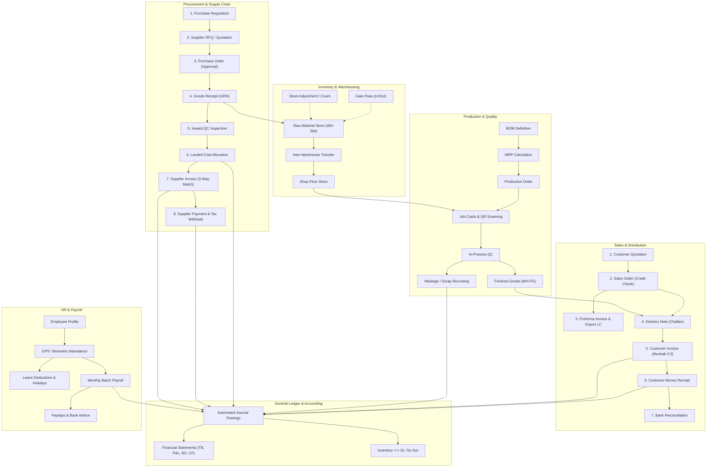

# BengalTex ERP – Business Workflow Map

**Document Version:** 1.0.0  
**Last Updated:** November 9, 2026  
**Context:** Garments Accessories Manufacturing (Zippers, Buttons, Threads, Labels, Elastic, Polybags)  
**Currency:** Bangladeshi Taka (BDT) + Export Foreign Currencies (USD, EUR)  
**Location:** Tejgaon Industrial Area, Dhaka, Bangladesh

---

## 1. End-to-End Workflow Architecture

---

## 2. Detailed Lifecycle Specifications

### 2.1 Procurement & Inward Logistics
1. **Requisition (PR):** Department initiates item requirement. Status: `Draft` -> `Submitted` -> `Approved` -> `Ordered`.
2. **Quotation (RFQ):** Vendor price bids entered. Side-by-side comparison matrix evaluates lowest compliant bidder.
3. **Purchase Order (PO):**
   - Automatically enqueued for approval if total exceeds configured threshold (`Approvals:PurchaseOrderThreshold: 50,000 BDT`).
   - Approved PO is locked from item mutations.
   - Triggers PDF generation and vendor dispatch.
4. **Goods Receipt (GRN):**
   - Warehouse validates physical quantities against PO. Supports partial receipts.
   - Items quarantined in `WH-QC` pending Quality Inspection.
5. **Quality Control (Inward):**
   - AQL sampling inspection performed.
   - Accepted stock moves to `WH-RM`.
   - Defective items move to `QuarantineDisposition` (Return to Vendor / Scrap / Concession).
6. **Landed Cost Voucher:**
   - Customs duty, shipping freight, and clearing charges allocated to received inventory items based on weight or value.
   - Adjusts moving average item unit cost and posts inventory GL debit.
7. **Supplier Invoice (AP):**
   - 3-Way matching verification: PO quantity vs GRN accepted quantity vs Vendor invoice amount.
   - Calculates Tax Deducted at Source (TDS) and VAT Deducted at Source (VDS).
8. **Payment Voucher:**
   - Bank cheque or EFT advice generated. Settles against open invoices. Automates GL voucher.

---

### 2.2 Manufacturing & Shop Floor Execution
1. **Bill of Materials (BOM):**
   - Multi-level hierarchical definition (e.g., Zipper -> Slider, Tape, Teeth element, Enamel paint).
   - Includes standard scrap percentage and labor/overhead run rates.
2. **MRP Explosion:**
   - Evaluates open Sales Orders against available stock and purchase orders in pipeline.
   - Generates recommended Purchase Requisitions for raw material shortages and Production Orders for finished goods.
3. **Production Order:**
   - Created with scheduled start/end dates and assigned to specific Work Centers / Machine lines.
   - Status progression: `Draft` -> `Confirmed` -> `In-Progress` -> `Completed` -> `Closed`.
4. **Job Cards & QR Scanning:**
   - Unique Job Card generated per production stage with barcode/QR code.
   - Shop floor operators use built-in camera QR scanner to record: `Start`, `Pause`, `Resume`, `Complete`, and `QC Check`.
   - Captures operator ID, machine ID, completed quantity, scrap quantity, and duration.
5. **Wastage & Scrap Sales:**
   - Wastage logged with mandatory reason codes (setup scrap, machine jam, defective raw material).
   - Scrap inventory tracked separately and sold via `ScrapSales` with immediate GL revenue recognition.

---

### 2.3 Sales, Export & Fulfillment
1. **Quotation & Samples:**
   - Quotation drafted with item unit prices, lead times, and terms.
   - Sample request lifecycle tracked with buyer approval stages before mass order confirmation.
2. **Sales Order (SO):**
   - Automated customer credit control checks total outstanding AR + order value against `Customer.CreditLimit`.
   - If over limit, order is blocked or sent to Admin approval queue.
   - Backed by buyer Master LC or Proforma Invoice.
3. **Proforma Invoice (PI):**
   - Export documentation generated with Harmonized System (HS) codes, freight terms (FOB/CIF), and banking coordinates for LC opening.
4. **Delivery Note (Challan):**
   - Warehouse dispatches goods from `WH-FG`.
   - Deducts physical inventory and records delivery challan number.
   - Accompanied by statutory Gate Pass.
5. **Customer Invoice (AR) & VAT 6.3:**
   - Generated directly from Delivery Notes.
   - Bangladesh NBR compliant Mushak 6.3 VAT Challan printed.
   - Automated GL debit to Accounts Receivable and credit to Sales Revenue + VAT Payable.
6. **Customer Receipt:**
   - Payment received via Bank Transfer, Cheque, or LC Negotiation.
   - Allocated to open invoices. Reconciles through Bank Reconciliation.

---

### 2.4 Human Resources & Automated Payroll
1. **Attendance Engine:**
   - Self-service mobile check-in validates device geolocation against factory coordinates ( తే Tejgong Tejgaon factory: `23.7600°N, 90.3900°E`, 500m radius).
   - Validates IP address and device fingerprint canvas to prevent buddy punching.
   - Anomaly engine flags late entries, early departures, and missing punches for manager approval.
2. **Leave Administration:**
   - Casual, Sick, and Earned leaves calculated per Bangladesh Labor Act.
   - Balances automatically updated upon approval.
3. **Monthly Batch Payroll:**
   - Automatically aggregates: Basic Salary + House Rent + Medical Allowance + Conveyance + Overtime Hours.
   - Deducts: Unapproved Absences + Late Fines + Loan Installments + Provident Fund + Tax Withheld.
   - Generates payslips with company branding and detailed salary breakdown.
   - Generates bank disbursement advice file and auto-posts payroll journal vouchers.

