# BengalTex ERP – Database Architecture & Schema Specification

**Document Version:** 1.0.0  
**Last Updated:** November 9, 2026  
**RDBMS:** Microsoft SQL Server (LocalDB in Development; SQL Server 2022 Standard/Enterprise in Production)  
**ORM:** Entity Framework Core 8.0.x with Code-First Migrations  
**Total Tables:** 156 Relational Tables

---

## 1. Schema Classification & Table Domains

The 156 database tables are organized into 10 logical business domains:

```mermaid
graph TD
    Identity["1. Identity & Security (11 Tables)"]
    Master["2. Master Data (18 Tables)"]
    Procure["3. Procurement & AP (21 Tables)"]
    Sales["4. Sales & AR (22 Tables)"]
    Inv["5. Inventory & Warehouse (17 Tables)"]
    Mfg["6. Manufacturing & QC (24 Tables)"]
    Acct["7. General Ledger & Assets (21 Tables)"]
    Bank["8. Banking & LC (9 Tables)"]
    HR["9. HR & Payroll (10 Tables)"]
    Audit["10. System, Jobs & Hangfire (3 Tables)"]
```



### Table Domain Directory:
1. **Identity & Security (11 tables):** `AspNetUsers`, `AspNetRoles`, `AspNetUserRoles`, `AspNetUserClaims`, `AspNetUserLogins`, `AspNetUserTokens`, `AspNetRoleClaims`, `RolePermissions`, `RefreshTokens`, `ApprovalRequests`, `ApprovalWorkflows`.
2. **Master Data (18 tables):** `Companies`, `Factories`, `OfficeLocations`, `Currencies`, `ExchangeRates`, `UnitsOfMeasure`, `Warehouses`, `Bins`, `ProductCategories`, `Products`, `ProductVariants`, `ProductPriceHistories`, `RawMaterials`, `RawMaterialSubstitutes`, `Customers`, `CustomerPricings`, `Suppliers`, `Styles`.
3. **Procurement & AP (21 tables):** `PurchaseRequisitions`, `PurchaseRequisitionItems`, `SupplierQuotations`, `SupplierQuotationItems`, `PurchaseOrders`, `PurchaseOrderItems`, `GoodsReceipts`, `GoodsReceiptItems`, `LandedCostVouchers`, `LandedCostAllocations`, `SupplierInvoices`, `SupplierInvoiceItems`, `Payments`, `PaymentAllocations`, `DebitNotes`, `DebitNoteItems`, `SupplierReturnNotes`, `SupplierReturnNoteItems`, `GatePasses`, `GatePassItems`, `Samples`.
4. **Sales & AR (22 tables):** `Quotations`, `QuotationItems`, `SalesOrders`, `SalesOrderItems`, `ProformaInvoices`, `ProformaInvoiceItems`, `DeliveryNotes`, `DeliveryNoteItems`, `CustomerInvoices`, `CustomerInvoiceItems`, `Receipts`, `ReceiptAllocations`, `CreditNotes`, `CreditNoteItems`, `CustomerReturnNotes`, `CustomerReturnNoteItems`, `ScrapSales`, `ScrapSaleItems`, `VatChallans`, `VatChallanItems`, `ExportIncentiveClaims`, `ExportIncentiveDisbursements`.
5. **Inventory & Warehousing (17 tables):** `Stocks`, `StockLots`, `StockMovements`, `StockAdjustments`, `StockAdjustmentItems`, `StockTransfers`, `StockTransferItems`, `OpeningStockEntries`, `InventoryGlMappings`, `BinStockSnapshots`, `QuarantineDispositions`, `QuarantineItems`, `GatePassAudits`.
6. **Manufacturing & QC (24 tables):** `Boms`, `BomItems`, `WorkCenters`, `Machines`, `MachineMaintenances`, `ProductionOrders`, `ProductionOrderItems`, `ProductionOrderStages`, `JobCards`, `JobCardStageLogs`, `MrpRuns`, `MrpRequirements`, `WastageEntries`, `WastageReasons`, `SubcontractOrders`, `SubcontractOrderItems`, `QcInspections`, `QcInspectionItems`, `CostingRates`, `ProductionCalendarEntries`.
7. **General Ledger & Assets (21 tables):** `Accounts`, `JournalEntries`, `JournalEntryLines`, `FinancialYears`, `FiscalPeriods`, `CostCenters`, `Budgets`, `BudgetAllocations`, `FixedAssets`, `AssetDepreciationRuns`, `AssetDepreciationLines`, `StatutoryRemittances`, `StatutoryCategories`, `CashBookSnapshots`, `BankBookSnapshots`, `DayBookSnapshots`.
8. **Banking & Commercial (9 tables):** `BankAccounts`, `BankFacilities`, `BankStatements`, `BankTransactions`, `LettersOfCredit`, `LcAmendments`, `LcFinancialEvents`, `LcDocumentSets`, `BankReconciliationRecords`.
9. **HR & Payroll (10 tables):** `Employees`, `EmployeeEducations`, `EmployeeEmergencyContacts`, `EmployeeSkills`, `EmployeeHistoryEntries`, `AttendanceRecords`, `AttendanceFlags`, `AttendanceRequests`, `LeaveApplications`, `LeaveBalances`, `LeaveTypes`, `Holidays`, `EmployeeLoans`, `EmployeeLoanInstallments`, `FestivalBonuses`, `PayrollRuns`, `Payslips`, `FinalSettlements`.
10. **System & Hangfire (3 base + Hangfire internal schema):** `AuditLogEntries`, `SentEmails`, `Notifications`, plus Hangfire schema (`[HangFire].[Job]`, `[HangFire].[State]`, `[HangFire].[Server]`, `[HangFire].[Counter]`, etc.).

---

## 2. Core Entity Standards & Design Rules

### 2.1 Base Entity Interface (`IAuditableEntity`)
Every business entity inherits from `BaseAuditableEntity` or implements `IAuditableEntity`:
```csharp
public abstract class BaseAuditableEntity : BaseEntity, IAuditableEntity
{
    public DateTimeOffset CreatedAt { get; set; } = DateTimeOffset.UtcNow;
    public string? CreatedBy { get; set; }
    public DateTimeOffset? LastModifiedAt { get; set; }
    public string? LastModifiedBy { get; set; }
    public byte[] RowVersion { get; set; } = Array.Empty<byte>();
}
```
* **Immutability of Audit Trails:** `CreatedAt` and `CreatedBy` are set in `ApplicationDbContext.SaveChangesAsync()` and protected against modification.
* **Concurrency Control:** `RowVersion` is configured as `[Timestamp]` (`IsRowVersion()`) for optimistic concurrency conflict detection.

### 2.2 Financial Integrity & Ledger Constraints
1. **Balanced Journal Rule:** Enforced in `JournalEntry` command handler before saving:
   $$\sum \text{DebitAmount} = \sum \text{CreditAmount}$$
   A voucher will throw `DomainValidationException` if the sum of debits does not equal the sum of credits.
2. **Immutability of Posted Documents:** Once a `JournalEntry`, `CustomerInvoice`, `SupplierInvoice`, or `Payment` status transitions to `Posted`, lines cannot be deleted or amounts altered. Adjustments require Credit/Debit Notes or Reversal Journals.
3. **Negative Stock Prohibition:** Inventory deduction operations (`IssueStock`, `DispatchDeliveryNote`) enforce that available on-hand stock in the specified warehouse/bin must be greater than or equal to requested quantity.

---

## 3. Indexing & Performance Strategy

Key composite and filtered indexes configured in EF Core Fluent API:
- `StockLots`: Composite index on `(RawMaterialId, WarehouseId, ExpiryDate)` for FIFO picking.
- `StockMovements`: Clustered/composite index on `(WarehouseId, ItemId, CreatedAt DESC)` for stock ledger queries.
- `JournalEntryLines`: Composite index on `(AccountId, FinancialYearId, PostingDate)` for instant Trial Balance and General Ledger aggregation.
- `AttendanceRecords`: Filtered index on `(EmployeeId, Date)` with unique constraint to prevent duplicate daily check-in parent rows.
- `AuditLogEntries`: Indexed on `(EntityName, EntityId, Timestamp DESC)` for rapid entity history lookups.

---

## 4. Foreign Key & Delete Behavior Conventions

- **Default Delete Behavior:** `DeleteBehavior.Restrict` or `DeleteBehavior.NoAction` across all transactional references.
- **Cascade Deletes:** Restricted solely to parent-child line item compositions (e.g., deleting a draft `SalesOrder` cascades to its `SalesOrderItem` children; deleting a posted order is blocked).
- **No Physical Deletions:** Critical business records (Accounts, Customers, Suppliers, Invoices, Orders) utilize soft deletion (`IsActive = false` or `IsDeleted = true`) with global query filters.

