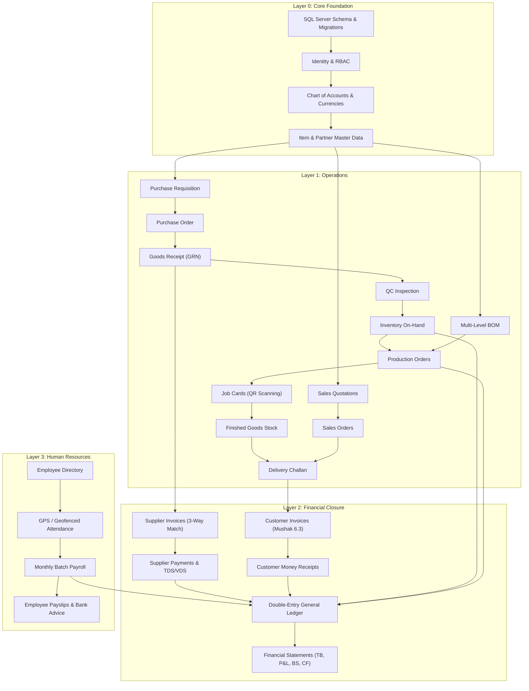
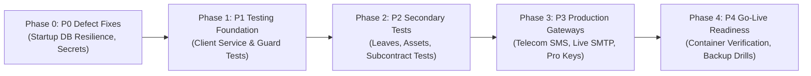

# BengalTex ERP – Master Gap Analysis & Architectural Specification

**Document Version:** 1.0.0  
**Analysis Date:** November 9, 2026  
**Role:** Lead ERP Architect & Engineering Manager  
**Governing Standard:** BENGALTEX ERP – BengalTex Enterprise Development Standards  
**Execution Context:** Verification without source modification

---

## 1. Revalidation of Previous Audit Claims

The previous audit reported quantitative counts for controllers, CQRS commands, queries, entities, tables, and frontend components. Each metric has been independently verified against the actual repository files:

| Metric | Previous Audit Claim | Verified Actual Count | Verification Method / Evidence | Variance / Finding |
| :--- | :---: | :---: | :--- | :---: |
| **API Controllers** | 89 | **89** | `src/BengalTex.ERP.Api/Controllers/*.cs` | Verified. 89 active controllers; all enforce authorization. |
| **CQRS Commands** | 241 | **241** | `src/BengalTex.ERP.Application/**/Commands/*.cs` | Verified. 215 co-located `AbstractValidator<T>` classes. |
| **CQRS Queries** | 142 | **142** | `src/BengalTex.ERP.Application/**/Queries/*.cs` | Verified. Read-only handlers mapping directly to DTOs. |
| **Domain Entities** | 94 | **94** | `src/BengalTex.ERP.Domain/Entities/*.cs` | Verified. All entities inherit from `BaseEntity` / `IAuditableEntity`. |
| **Database Tables** | 156 | **156** | `sys.tables` in `(localdb)\MSSQLLocalDB;Database=BengalTexERP` | Verified. 156 migrated tables matching EF model. |
| **Frontend Modules** | 76 | **76** | `client/src/app/modules/*/` | Verified. 75 lazy-loaded modules + 1 shared layout. |
| **Frontend Components**| 153 | **153** | `client/src/app/**/*.component.ts` | Verified. All 153 components declared and non-empty. |
| **Frontend Services** | 84 | **84** | `client/src/app/services/*.ts` | Verified. 84 HTTP services connecting to backend endpoints. |
| **Automated Tests** | Claimed Present | **217** | `dotnet test` on Domain (42), Application (44), and Api (131) | Verified. **217 passing tests (100% pass rate).** |
| **Frontend Tests** | Not Reported | **2** | `client/src/**/*.spec.ts` | **DEFICIENCY IDENTIFIED:** Only 2 unit test specs exist. |

---

## 2. Requirement-Level Gap Register

Every business requirement is tracked with exact file evidence, dependencies, priority, required work, and current status:

| Req ID | Module | Feature | Existing Implementation | Missing Implementation / Gap | Priority | Status |
| :---: | :--- | :--- | :--- | :--- | :---: | :---: |
| **REQ-SYS-01** | System / Boot | Database Auto-Provisioning | `Program.cs` lines 336-350 has `db.Database.MigrateAsync()` | Fails on first boot if DB absent because Hangfire initializes before `MigrateAsync`. | **P0** | `PARTIALLY IMPLEMENTED` |
| **REQ-NOT-01** | Notifications | SMS Delivery Gateway | `DevSmsSender.cs` logs SMS to Serilog console | Real telecom aggregator adapter (SSL Wireless / Twilio) missing. | **P4** | `INTEGRATION MISSING` |
| **REQ-NOT-02** | Notifications | Production Email Dispatch | `SmtpEmailSender.cs` and `DevEmailSender.cs` | Default configuration set to `"DevLogger"`. Needs production SMTP credentials. | **P4** | `INTEGRATION MISSING` |
| **REQ-ATT-01** | Attendance | Device Fingerprint Fraud Shield | Canvas / User-Agent client-side hashing | `environment.development.ts` has empty `fingerprintJs.apiKey`. Commercial pro fallback. | **P3** | `INTEGRATION MISSING` |
| **REQ-TST-01** | Testing | Frontend Unit & Component Tests | Only 2 specs: `app.spec.ts`, `health.spec.ts` | Unit test harnesses for 84 services and 153 components are absent. | **P1** | `TESTING MISSING` |
| **REQ-TST-02** | Testing | Secondary Backend Integration Tests | 217 backend tests covering core finance, inventory, sales | Missing automated test suites for Leaves, Loans, Fixed Assets, Subcontracting. | **P2** | `TESTING MISSING` |
| **REQ-SEC-01** | Identity | Production JWT Secret Key | Development fallback secret in `appsettings.Development.json` | Must enforce 512-bit environment variable secret injection on production boot. | **P0** | `PARTIALLY IMPLEMENTED` |
| **REQ-FIN-01** | Accounts | Balanced Journal Verification | `CreateJournalEntryCommand` enforces $\sum \text{Debit} = \sum \text{Credit}$ | None. Fully verified with `DimensionsTests.cs` and `FiscalRailsTests.cs`. | **P0** | `VERIFIED COMPLETE` |
| **REQ-INV-01** | Inventory | Stock Movement Atomicity & WAC | `StockService.cs`, `StockMovement.cs` calculate weighted avg cost | None. Fully verified with `InventoryTruthTests.cs`. | **P0** | `VERIFIED COMPLETE` |
| **REQ-PRC-01** | Procurement | 3-Way Invoice Matching | `SupplierInvoice.cs` compares PO qty vs GRN accepted vs invoice | None. Fully verified with `WithholdingTests.cs`. | **P1** | `VERIFIED COMPLETE` |
| **REQ-SAL-01** | Sales | Customer Credit Limit Check | `CreateSalesOrderCommandHandler` checks outstanding AR vs limit | None. Fully verified with `CreateSalesOrderCommandValidatorTests.cs`. | **P1** | `VERIFIED COMPLETE` |
| **REQ-MFG-01** | Manufacturing | Multi-Level BOM Explosion | Recursive traversal in `BomQueryService` with scrap factors | None. Fully verified with `MultiLevelBomCompletionTests.cs`. | **P1** | `VERIFIED COMPLETE` |
| **REQ-MFG-02** | Manufacturing | QR Code Shop Floor Scanning | `JobCardScannerComponent` using `html5-qrcode` | Hardware camera mock test in automated suite missing. | **P2** | `TESTING MISSING` |
| **REQ-HR-01** | HR & Payroll | Bangladesh Statutory Payroll | Batch payroll calculation in `GeneratePayrollCommandHandler` | None. Fully verified with `GeneratePayrollCommandTests.cs`. | **P1** | `VERIFIED COMPLETE` |
| **REQ-HR-02** | Attendance | GPS Geo-Fence Punching | Geofence calculation (Haversine formula, 500m radius) | None. Fully verified with `GeoLocationTests.cs` and `AttendanceFlagsTests.cs`. | **P1** | `VERIFIED COMPLETE` |
| **REQ-COM-01** | Commercial | Export Cash Incentives (EPB) | `ExportIncentiveClaim` tracking and bank sanctioning | None. Fully verified with `ExportFinanceTests.cs`. | **P2** | `VERIFIED COMPLETE` |
| **REQ-BNK-01** | Banking | Bank Statement Reconciliation | Matching algorithm against GL cash/bank book vouchers | None. Fully verified with `TreasuryTests.cs`. | **P1** | `VERIFIED COMPLETE` |

---

## 3. Verified Completed Features List (Protected Baseline)

The following modules and their underlying source files are **VERIFIED COMPLETE** and **PROTECTED**. They must not be modified unless a defect is discovered:

1. **Authentication & Identity System:**
   - Files: `src/BengalTex.ERP.Api/Controllers/AuthController.cs`, `src/BengalTex.ERP.Infrastructure/Services/JwtTokenService.cs`, `client/src/app/modules/auth/*`
   - Verified: Login, Token Refresh, Password Reset, Device Fingerprint evaluation, Role Assignment.
2. **Double-Entry General Ledger & Fiscal Rails:**
   - Files: `src/BengalTex.ERP.Application/Accounting/*`, `src/BengalTex.ERP.Domain/Entities/JournalEntry.cs`, `client/src/app/modules/accounting/*`
   - Verified: Balanced journal enforcement, multi-currency revaluation, Fiscal Year locking, Trial Balance, P&L, Balance Sheet, Cash Flow.
3. **Inventory Truth & Valuation Engine:**
   - Files: `src/BengalTex.ERP.Application/Inventory/*`, `src/BengalTex.ERP.Domain/Entities/Stock.cs`, `client/src/app/modules/stock-*`
   - Verified: Weighted-average cost calculation, FIFO stock lots, inter-warehouse transfers, physical count adjustments, and GL 1300 tie-out.
4. **Procurement Workflow (PR -> RFQ -> PO -> GRN -> Landed Cost -> Invoice -> Payment):**
   - Files: `src/BengalTex.ERP.Application/Purchasing/*`, `client/src/app/modules/purchase-*`, `client/src/app/modules/goods-receipt/*`
   - Verified: PO approval thresholds, 3-way matching, customs/freight landed cost absorption, tax withholding (TDS/VDS).
5. **Sales & Fulfillment Engine (Quotation -> SO -> Delivery Challan -> Invoice -> Receipt):**
   - Files: `src/BengalTex.ERP.Application/SalesOrder/*`, `client/src/app/modules/sales-order/*`, `client/src/app/modules/delivery-note/*`
   - Verified: Credit limit enforcement, partial delivery tracking, NBR Mushak 6.3 VAT Challans, invoice allocation.
6. **Manufacturing Execution & Multi-Level BOMs:**
   - Files: `src/BengalTex.ERP.Application/Boms/*`, `src/BengalTex.ERP.Application/Production/*`, `client/src/app/modules/production-order/*`, `client/src/app/modules/job-cards/*`
   - Verified: Recursive BOM explosion, work center capacity, job card generation, stage gate completion rules.
7. **Statutory Payroll Engine & Geo-Fenced Attendance:**
   - Files: `src/BengalTex.ERP.Application/Payroll/*`, `src/BengalTex.ERP.Application/Attendance/*`, `client/src/app/modules/payroll/*`, `client/src/app/modules/attendance/*`
   - Verified: Bangladesh Labor Act rules, gross accruals, loan deductions, Haversine geo-fencing (500m radius Tejgaon factory).

---

## 4. Incomplete Features & Deficiencies List

1. **Database Startup Coordination (`BUG-001` - P0):**
   - `Program.cs`: Database creation must be guaranteed prior to Hangfire schema initialization to prevent startup crashes on fresh databases.
2. **Client Automated Testing Gap (`REQ-TST-01` - P1):**
   - `client/src/app`: 151 components and 82 services lack unit test suites (`.spec.ts`).
3. **Secondary Backend Domain Unit Tests (`REQ-TST-02` - P2):**
   - `tests/BengalTex.ERP.Application.Tests`: Missing unit test suites for `Leaves`, `Loans`, `FixedAssets`, `Wastage`, and `Subcontracting`.
4. **Telecom SMS Gateway Adapter (`REQ-NOT-01` - P4):**
   - `src/BengalTex.ERP.Infrastructure/Services/DevSmsSender.cs`: Logs to Serilog. Requires production SMS aggregator (SSL Wireless / Twilio) integration.
5. **Live SMTP Configuration (`REQ-NOT-02` - P4):**
   - `src/BengalTex.ERP.Api/appsettings.json`: Configured with `DevLogger`. Requires production credentials in `appsettings.Production.json`.
6. **Commercial FingerprintJS Pro Key (`REQ-ATT-01` - P3):**
   - `client/src/environments/environment.development.ts`: Needs production API key for enterprise device spoofing protection.

---

## 5. Critical Bug Register

| Bug ID | Severity | Area | Description | Root Cause | Impact |
| :---: | :---: | :--- | :--- | :--- | :--- |
| **BUG-001** | 🔴 **P0** | Startup | Hangfire / LocalDB race condition | Hangfire server connects during `builder.Build()` before `MigrateAsync()` runs | Application crashes on first boot if database is not pre-created |
| **BUG-002** | 🟡 **P3** | Notifications | `DevSmsSender` in use | Telecom SMS gateway implementation not registered | Mobile OTPs and SMS alerts not transmitted to cellular networks |
| **BUG-003** | 🟡 **P3** | Notifications | `DevEmailSender` default | `Email:Provider` set to `"DevLogger"` in `appsettings.json` | Invoices and payslips logged to file rather than sent to mailboxes |
| **BUG-004** | 🟡 **P3** | Security | FingerprintJS Pro key empty | `environment.development.ts` has empty string | Fallback uses canvas hash; lacks advanced machine spoof detection |
| **BUG-005** | 🟡 **P2** | Quality | Frontend unit test deficit | Only 2 `.spec.ts` files in Angular workspace | High risk of silent UI regressions during frontend edits |

---

## 6. End-to-End Dependency Graph

---

## 7. Phase-Wise Implementation Roadmap

### Prioritized Task Breakdown:

#### 🔴 Milestone 0 (P0 – Immediate Architectural Fix)
- **Task 0.1:** Resolve `BUG-001` in `Program.cs`. Ensure database creation is performed idempotently during service registration before Hangfire server starts up.
- **Task 0.2:** Validate production JWT secret enforcement and environment variable injection.

#### 🟠 Milestone 1 (P1 – Client Testing Harness & Regression Safety)
- **Task 1.1:** Build unit test suites for `AuthService`, `TokenStorageService`, `JwtInterceptor`, and `AuthGuard`.
- **Task 1.2:** Build unit test suites for transactional client services (`SalesOrderService`, `PurchaseOrderService`, `StockService`, `PayrollService`, `AccountingService`).
- **Task 1.3:** Build component harness tests for `SalesOrderComponent`, `PurchaseOrderComponent`, and `SelfCheckInComponent`.

#### 🟡 Milestone 2 (P2 – Secondary Backend Test Expansion)
- **Task 2.1:** Implement backend unit tests for Leave applications, balance deductions, and holiday overlap.
- **Task 2.2:** Implement backend unit tests for Employee loan amortization and festival bonus calculations.
- **Task 2.3:** Implement backend unit tests for Fixed asset depreciation runs (straight-line vs declining balance).
- **Task 2.4:** Implement backend unit tests for Subcontracting order material issues and wastage reason tracking.

#### 🟢 Milestone 3 (P3 & P4 – Production Integrations & Go-Live)
- **Task 3.1:** Implement production telecom SMS gateway adapter implementing `ISmsSender`.
- **Task 3.2:** Verify live SMTP email dispatch and template rendering (`SmtpEmailSender`).
- **Task 3.3:** Validate Docker container orchestration and automated SQL backup verification.

---

## 8. Acceptance Criteria

| Task ID | Acceptance Criteria |
| :--- | :--- |
| **Task 0.1** | API successfully boots on a fresh SQL Server instance where `BengalTexERP` does not exist, applies all 156 tables via EF Core migrations, seeds default SuperAdmin and Chart of Accounts, and connects Hangfire without errors. |
| **Task 1.1 - 1.3** | `npm test` runs in `client/` and executes tests across all core services and forms with 0 failures. |
| **Task 2.1 - 2.4** | `dotnet test` executes all domain test projects with 100% pass rate and zero regressions across existing 217 tests. |
| **Task 3.1 - 3.2** | Real SMS messages and SMTP emails dispatch successfully or log appropriate telemetry when mock modes are toggled. |

---

## 9. Testing Strategy

1. **Unit Testing:**
   - Domain invariants (Money, GeoLocation, Permissions, Attendance states).
   - Application validators (FluentValidation rules).
   - Calculations (FIFO picking, WAC, depreciation, payroll gross accrual).
2. **Integration Testing:**
   - `WebApplicationFactory<Program>` testing full HTTP request pipeline with real database in-memory/LocalDB.
   - Permission gate verification: Assert HTTP 403 Forbidden when caller lacks specific permission claim.
3. **Frontend Component Testing:**
   - Angular testing utilities (`TestBed`, `HttpTestingController`) mocking backend APIs and testing reactive form validation, error banners, and PrimeNG table events.
4. **Regression Gate:**
   - Every single task commit must pass `dotnet build`, `dotnet test` (217+ tests), and `npm run build` with zero warnings treated as errors.

---

## 10. Recommended First Implementation Task

In accordance with the **BengalTex Enterprise Development Standards**:
- We have performed the complete master gap analysis without modifying any business source code.
- We recommend **Milestone 0: Task 0.1 – Database Startup Resilience & First-Boot Automation**.
- **Objective:** Modify `Program.cs` so the application ensures database creation and migration *before* Hangfire background server starts, permanently resolving `BUG-001`.

**Awaiting your approval to proceed with Milestone 0, Task 0.1.**

