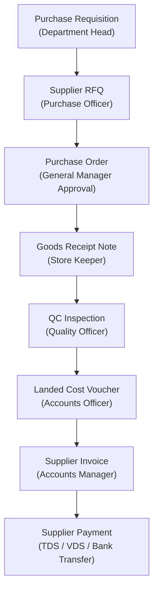
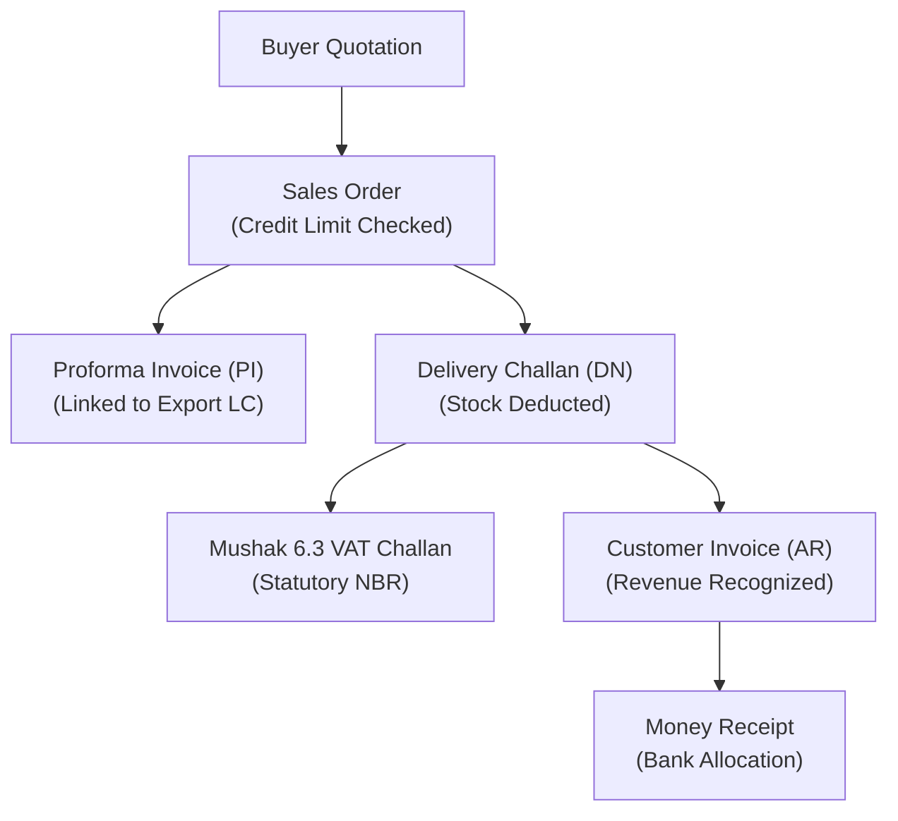

# BengalTex ERP – Operator & User Manual

**Document Version:** 1.0.0 – Production Operator Manual  
**Target Audience:** System Administrators, Commercial Officers, Merchandisers, Store Keepers, Production Managers, Accountants, and HR Officers  
**Business Context:** Garments Accessories Manufacturing (Zippers, Buttons, Sewing Thread, Labels, Elastics)  
**Currency:** Bangladesh Taka (BDT)  

---

## 1. System Navigation & UI Tour

BengalTex ERP features a responsive Single Page Application (SPA) interface built with Angular 21 and PrimeNG:

- **Top Navigation Bar:**
  - **Company Logo & Branch Selector:** Switch active factory branch/warehouse.
  - **Quick Search:** Instant navigation across menu items and documents.
  - **Notification Bell:** Live system alerts (low stock, pending approvals, late attendance).
  - **User Profile Menu:** Access personal profile, self-check-in status, and password change.
- **Left Sidebar Menu:**
  - Organized hierarchically into functional modules: *Dashboard, Master Data, Procurement, Production, Inventory, Sales, Accounting, Banking, HR & Attendance, Payroll, Reports, Settings*.
- **Data Tables:**
  - Search filter bar, multi-column sorting, pagination controls (10, 25, 50, 100 rows), and Excel/PDF export buttons.

---

## 2. Phase 1: Foundation & Master Data Setup

> **Operational Principle:** Always establish master records in dependency order before attempting business transactions.

### 2.1 Currency & Units of Measure
1. Navigate to **Master Data $\rightarrow$ Currencies**. Ensure base currency `BDT` is set as default. Define foreign currencies (`USD`, `EUR`, `RMB`) with current exchange rates against BDT.
2. Navigate to **Master Data $\rightarrow$ Units of Measure**. Configure standard accessory units:
   - `PCS` (Pieces), `DZN` (Dozen = 12 PCS), `GG` (Great Gross = 1,728 PCS), `YDS` (Yards), `MTR` (Meters), `KG` (Kilograms), `CONE` (Cones for sewing thread).

### 2.2 Warehouse & Bin Layout
1. Navigate to **Inventory $\rightarrow$ Warehouses**. Setup logical storage zones:
   - `RM-WH` (Raw Material Warehouse - Tejgaon)
   - `FG-WH` (Finished Goods Warehouse - Tejgaon)
   - `QR-WH` (Quarantine & Inspection Area)
   - `SCRAP-WH` (Scrap & Rejection Store)
2. Define storage bins within each warehouse (e.g. `RACK-A1`, `RACK-A2`, `BIN-01`).

### 2.3 Catalog: Products & Raw Materials
1. **Raw Materials:** Navigate to **Master Data $\rightarrow$ Raw Materials**.
   - Example items: `Polyester Yarn 150D/1`, `Brass Wire #5`, `Zinc Ingot Zamak-3`, `Dyeing Chemical Acid Red`, `Woven Label Polyester Thread`.
2. **Finished Products:** Navigate to **Master Data $\rightarrow$ Products**.
   - Example items: `#5 Metal Open-End Zipper 60cm Black`, `24L 4-Hole Resin Button Pearl White`, `40/2 Spun Polyester Thread 5000M Cone`.
   - Set Item Type, Category, Base UoM, Standard Cost, and Selling Price.

---

## 3. Phase 2: Procurement Cycle (Inward Materials)

### 3.1 Step-by-Step Purchase Workflow
1. **Purchase Requisition (PR):** Department initiates a demand for raw materials. Head of Department submits $\rightarrow$ Approves.
2. **Supplier RFQ & Quotation Comparison:** Send RFQ to 3 suppliers. Enter received quotation prices into **Procurement $\rightarrow$ Supplier Quotations**. Use the **Compare Quotations** view to evaluate the lowest compliant vendor.
3. **Purchase Order (PO):** Convert approved quotation to PO. If total exceeds approval threshold, route for Management Approval. Once approved, the PO locks against edits.
4. **Goods Receipt Note (GRN):** When the delivery truck arrives, Store Keeper opens **Procurement $\rightarrow$ Goods Receipts $\rightarrow$ Create from PO**. Select PO number. Enter received quantities. Accepted items are held in `QR-WH` pending inspection.
5. **Landed Cost Voucher:** If freight, customs duty, or clearing charges apply, open **Procurement $\rightarrow$ Landed Cost**. Enter import costs; allocate by value or weight. The system recalculates inventory Weighted Average Cost (WAC).
6. **3-Way Matching Invoice:** Accounts Officer opens **Procurement $\rightarrow$ Supplier Invoices $\rightarrow$ New**. System validates PO quantity vs. GRN accepted quantity vs. vendor invoice bill. TDS and VDS withholding are automatically computed.
7. **Payment Voucher:** Open **Procurement $\rightarrow$ Payments**. Settle outstanding supplier invoice via Bank Transfer or Cheque. Double-entry vouchers post automatically (`Dr Accounts Payable / Cr Bank Account / Cr TDS Payable`).

---

## 4. Phase 3: Manufacturing, BOM & Job Cards

### 4.1 Bill of Materials (BOM)
1. Open **Production $\rightarrow$ Bill of Materials $\rightarrow$ Create BOM**.
2. Select parent finished product (e.g. `#5 Metal Open-End Zipper 60cm`).
3. Add raw material components with required quantities and scrap allowances:
   - `Polyester Tape`: 1.25 Meters (Scrap: 2.0%)
   - `Brass Wire #5`: 0.045 KG (Scrap: 3.5%)
   - `Slider Body`: 1.0 PCS (Scrap: 1.0%)
   - `Top & Bottom Stops`: 2.0 PCS
4. Save and activate BOM status to `Approved`.

### 4.2 Production Orders & Job Cards
1. Open **Production $\rightarrow$ Production Orders $\rightarrow$ New**.
2. Select BOM and target order quantity (e.g. 5,000 PCS). The system auto-generates sequential routing stages:
   - *Stage 1: Tape Weaving $\rightarrow$ Stage 2: Teeth Planting $\rightarrow$ Stage 3: Dyeing $\rightarrow$ Stage 4: Slider Mounting $\rightarrow$ Stage 5: Final QC & Packing*.
3. Click **Issue Job Cards**. System generates printed Job Cards with individual QR codes for each production stage.
4. **Shop Floor Scanning:** Machine operators scan the QR code using the **Job Card Scanner** (`html5-qrcode`) on factory mobile tablets to log start times, completed quantities, and reject counts.
5. Once final packing is cleared by QC, finished goods automatically transfer to `FG-WH` stock.

---

## 5. Phase 4: Sales, Dispatch & Commercial Billing

### 5.1 Sales Fulfillment Steps
1. **Sales Order (SO):** Open **Sales $\rightarrow$ Sales Orders $\rightarrow$ Create**. Select Buyer, style reference, and delivery date. If buyer's outstanding receivables exceed their approved credit limit, the order requires Executive Credit Override.
2. **Delivery Challan (Challan):** Open **Sales $\rightarrow$ Delivery Notes $\rightarrow$ New from SO**. Enter dispatch quantities. Clicking **Confirm Dispatch** immediately deducts inventory from `FG-WH` and updates the permanent stock ledger.
3. **NBR Mushak 6.3 VAT Challan:** Print the statutory government VAT challan directly from the delivery note view with unique sequence numbering.
4. **Customer Invoice:** Convert Delivery Challan to Customer Invoice. System automatically posts double-entry revenue journal (`Dr Accounts Receivable / Cr Sales Revenue / Cr Output VAT Payable`).
5. **Customer Receipt:** When export proceeds or cheque payments arrive, open **Sales $\rightarrow$ Receipts**. Allocate funds against open customer invoices.

---

## 6. Phase 5: General Ledger, Banking & Financial Reports

1. **Double-Entry Journal Entries:** Open **Accounting $\rightarrow$ Journal Entries**. Enter balanced vouchers. The system prohibits saving any voucher where total debits do not equal total credits.
2. **Stock ↔ GL Tie-Out:** Open **Accounting $\rightarrow$ Inventory GL Tie-Out**. The report reconciles perpetual stock valuation against General Ledger Account 1300 in real time. Zero variance confirms inventory accounting integrity.
3. **Financial Statements:**
   - **Trial Balance:** Filter by period; drill down directly from any account to underlying journal vouchers.
   - **Profit & Loss:** Review Gross Margin, Operating Expenses, and Net Profit.
   - **Balance Sheet:** Real-time snapshot of Assets, Liabilities, and Equity.
   - **Cash Flow:** Operating, Investing, and Financing cash movements.
4. **Bank Reconciliation:** Navigate to **Banking $\rightarrow$ Bank Reconciliation**. Match uploaded bank statement CSV lines against GL bank book vouchers.

---

## 7. Phase 6: HR, Attendance, Loans & Payroll

1. **GPS Geo-Fenced Self Check-In:**
   - Employees navigate to **Attendance $\rightarrow$ Self Check-In** on mobile or browser.
   - The browser prompts for GPS location. If the employee is within 500 meters of the factory (Tejgaon Industrial Area), the punch registers as valid.
   - Punches outside 500m are flagged with `GEO_FENCE_VIOLATION`.
2. **Employee Loans & Advances:**
   - Navigate to **Loans & Bonuses $\rightarrow$ Employee Loans $\rightarrow$ New Loan**.
   - Enter Principal, Monthly EMI, Tenure, and Disbursement method. System generates disbursement journal (`Dr 1190 Employee Loans / Cr 1010 Bank`).
   - During monthly payroll, installments automatically deduct from net salary. When loan balance reaches zero, the loan status automatically flips to `Closed`.
3. **Monthly Batch Payroll:**
   - Navigate to **Payroll $\rightarrow$ Generate Payroll**.
   - Select Year and Month (e.g. `2026-05`). System calculates Gross Pay, Overtime (2x hourly), Unpaid Leave deductions, and Loan EMIs.
   - Click **Approve Payroll Run**. System generates bulk salary journal (`Dr 5010 Salary Expense / Cr 2030 Salary Payable / Cr 1190 Employee Loans`) and produces bank salary transfer advice.
4. **Festival Bonuses:**
   - Navigate to **Loans & Bonuses $\rightarrow$ Festival Bonuses $\rightarrow$ Bulk Create**.
   - Select Bonus Type (`Eid-ul-Fitr`, `Eid-ul-Azha`, `Pohela Boishakh`), year, and percentage of basic salary.
   - Duplicate prevention guards guarantee zero double-disbursements for the same employee, year, and festival type.

---

## 8. Frequently Asked Questions (FAQ) & Troubleshooting

### Q1: Why is a dropdown list empty when creating a Purchase Order?
**Answer:** Master data must be created first. Ensure Supplier, Product, Currency, and Warehouse records exist and are active.

### Q2: Why does the system block approving a Sales Order?
**Answer:** The customer has exceeded their credit limit. An executive user with `SalesOrders.Approve` must grant a credit override, or the customer must clear pending invoices.

### Q3: Why does self check-in show "Geofence Violation"?
**Answer:** The device's GPS reports a coordinate further than 500 meters from the registered factory office location. Ensure location permissions are enabled on the mobile device.

### Q4: Can an approved Purchase Order or Invoice be modified?
**Answer:** No. In accordance with internal financial control standards, approved documents are locked. To adjust an approved invoice, issue a formal Credit Note or Debit Note.

